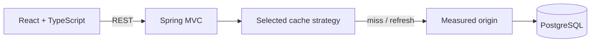

# HerdShield

**Cache stampede protection and cache-behavior laboratory**

HerdShield is a full-stack engineering project for reproducing high-concurrency cache failures and proving how targeted algorithms change the outcome. It is intentionally one Spring Boot backend, one PostgreSQL database, one React dashboard, and an in-process Caffeine cache.

The centerpiece is per-key request coalescing: concurrent misses for the same key share one `CompletableFuture`, while unrelated keys continue independently.

## What this project demonstrates

| Failure mode | Baseline | Mitigation | Proof signal |
| --- | --- | --- | --- |
| Cache stampede | Naive cache-aside | Per-key single-flight | Origin loads for 100+ same-key misses |
| Freshness/latency tension | Blocking reload | Stale-while-revalidate | Stale responses and one background refresh |
| Cache avalanche | Fixed TTL | Deterministic TTL jitter | Expiration histogram and peak origin bucket |
| Cache penetration | Repeated uncached 404 | Short typed negative cache | Negative-cache hits and origin loads |
| Write staleness | No coordination | Post-write invalidation + generations | Old in-flight result cannot repopulate cache |

No Redis is required. That is deliberate: the project studies one-process cache concurrency deeply before introducing distributed coordination.

## Five-minute demo

Requirements: Docker with Compose.

```bash
cp .env.example .env
docker compose up --build
```

Open [http://localhost:3000](http://localhost:3000), then:

1. Open **Compare**.
2. Keep 200 requests, 100 concurrency, and 75 ms controlled latency.
3. Run the comparison.
4. Inspect the measured origin-load counts for naive cache-aside and single-flight.
5. Open **Cache** to inspect entries or **Experiment** to run SWR, negative-cache, and avalanche scenarios.

PostgreSQL is seeded with 250 products. Product `42` is the default hot key.

## Architecture



The product domain is intentionally boring. All cache strategies receive the same loader function and return a typed `LoadResult<ProductResponse>`, which keeps missing data separate from infrastructure failure.

Read [PROJECT_PLAN.md](docs/PROJECT_PLAN.md) and [ARCHITECTURE.md](docs/ARCHITECTURE.md) before reading the implementation.

## Strategies

### `NAIVE_CACHE_ASIDE`

Performs check → query → put with no coordination. The cache is thread-safe, but that multi-step workflow is not atomic. It exists to make the stampede visible.

### `SINGLE_FLIGHT`

- `ConcurrentHashMap` stores one active future per key.
- `putIfAbsent` elects the leader.
- Followers join the existing future.
- Success, failure, rejection, and timeout clean up with `remove(key, sameFuture)`.
- A per-key generation prevents an invalidated load from repopulating the cache.
- There is no global `synchronized` block.

### `STALE_WHILE_REVALIDATE`

Stores two monotonic deadlines. Fresh values return normally. Stale-but-servable values return immediately and elect one background refresher. After the hard stale deadline, callers block behind one load. Refresh failure does not extend the old hard deadline.

### `TTL_JITTER`

Computes a deterministic offset in `[-jitter, +jitter]` from the key and experiment seed. The same seed reproduces the same buckets. Jitter addresses many-key expiration clustering; it does not prevent a stampede for one hot key.

### `NEGATIVE_CACHE`

Caches a typed empty `LoadResult` for a separate short TTL. A thrown origin exception never becomes `NOT_FOUND`.

## API

### Read a product

```http
GET /api/products/42?strategy=SINGLE_FLIGHT&ttlMs=30000&originMode=REAL_DATABASE
```

### Update and invalidate

```http
PUT /api/products/42
Content-Type: application/json

{
  "name": "Updated lab product",
  "description": "The database is authoritative.",
  "price": 49.95,
  "stock": 73
}
```

### Run a controlled experiment

```bash
curl -sS http://localhost:8080/api/experiments \
  -H 'Content-Type: application/json' \
  -d '{
    "strategy": "SINGLE_FLIGHT",
    "key": 42,
    "requests": 500,
    "concurrency": 100,
    "keyCount": 1,
    "ttlMs": 1000,
    "staleTtlMs": 1000,
    "negativeTtlMs": 500,
    "loadTimeoutMs": 5000,
    "jitterMs": 0,
    "jitterSeed": 42,
    "originMode": "CONTROLLED_LATENCY",
    "originLatencyMs": 75,
    "clearCacheBeforeRun": true,
    "warmCache": false,
    "waitForExpiry": false,
    "scheduleAtExpiry": false,
    "expirationBucketMs": 100
  }'
```

### Laboratory controls

| Method | Path | Purpose |
| --- | --- | --- |
| `GET` | `/api/metrics` | Current bounded metrics snapshot |
| `POST` | `/api/metrics/reset` | Reset application metrics |
| `GET` | `/api/cache` | Inspect entries and in-flight counts |
| `DELETE` | `/api/cache` | Clear every strategy cache |
| `GET` | `/actuator/health` | Container health |

## Running without Compose

Start PostgreSQL, then:

```bash
cd backend
mvn spring-boot:run
```

In another terminal:

```bash
cd frontend
npm ci
npm run dev
```

The Vite server proxies `/api` to port `8080`.

## Tests

```bash
cd backend
mvn verify

cd ../frontend
npm ci
npm run lint
npm run build
```

The concurrency suite covers:

- 100 simultaneous naive same-key misses producing many loads;
- 100 simultaneous single-flight misses producing one load window;
- loader failure propagation and cleanup;
- timeout cleanup;
- independent keys loading in parallel;
- invalidation during load;
- repeated missing keys;
- one refresh under 100 stale callers;
- bounded deterministic TTL jitter;
- PostgreSQL type behavior through Testcontainers (skipped only when Docker is unavailable).

## Benchmarks

Run all supplied scenarios after the stack is healthy:

```bash
./scripts/run-benchmarks.sh
```

Raw JSON is written to `benchmark-results/`. Copy only measured results into [BENCHMARK_RESULTS.md](docs/BENCHMARK_RESULTS.md) and the metrics-based resume bullets. The repository intentionally ships with no fabricated numbers.

## Repository map

```text
backend/                  Spring Boot application and tests
  src/main/.../cache/     contracts, policies, concurrency primitives
  src/main/.../strategy/  five independent cache strategies
  src/main/.../experiment controlled worker engine
frontend/                 React dashboard
scripts/                  reproducible benchmark runner
docs/                     design, references, interview and resume material
SDE1_AUDIT.md             scope and interview-defensibility audit
docker-compose.yml        PostgreSQL + backend + frontend
```

## Design boundaries

- In-process single-flight protects one application instance. Multiple backend replicas would need a distributed coordination design or tolerate one load per instance.
- Timeout removes the coordination window; it cannot guarantee that a JDBC driver has stopped underlying work.
- A read already overlapping a write may return its earlier snapshot. Generation checks prevent that older load from becoming the next cached value.
- Metrics reset is a laboratory control, not a transactional observability operation.
- Controlled latency is additive to a real repository query; the project does not rely exclusively on sleeping to pretend there is an origin.

## Documentation

- [Project plan](docs/PROJECT_PLAN.md)
- [Architecture](docs/ARCHITECTURE.md)
- [Reference review](docs/REFERENCES.md)
- [Benchmark protocol/results template](docs/BENCHMARK_RESULTS.md)
- [Verification status](docs/VERIFICATION.md)
- [Interview guide](docs/INTERVIEW_GUIDE.md)
- [Resume bullets](docs/RESUME_BULLETS.md)
- [SDE-1 audit](SDE1_AUDIT.md)
