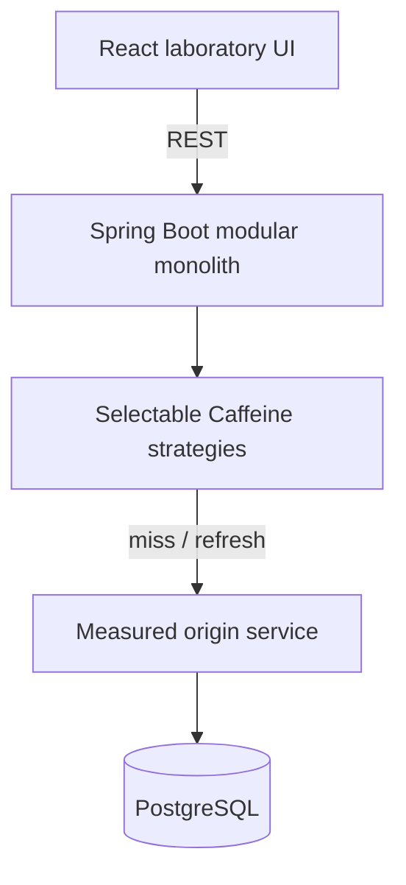
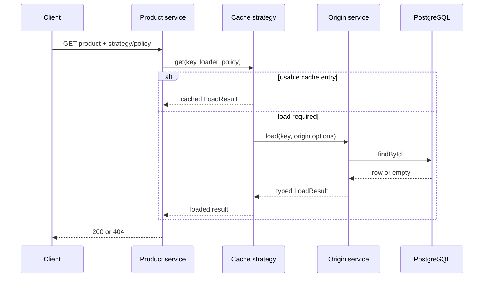
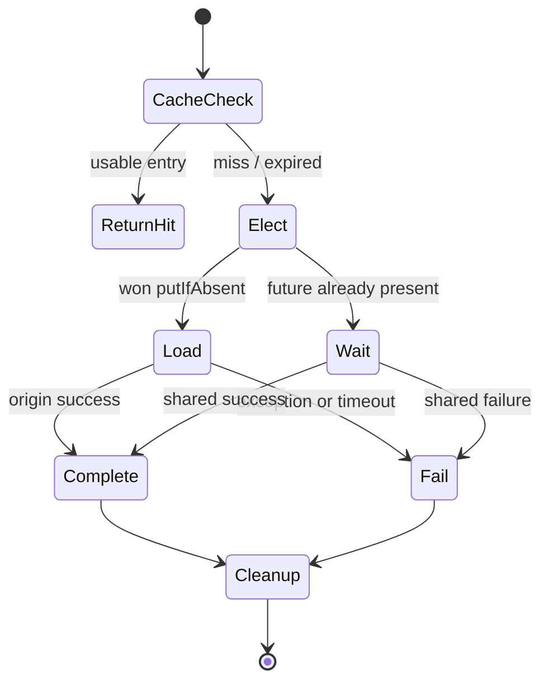

# HerdShield Architecture

## System context

There is one deployment unit for application logic and one database. Cache strategies sit behind the same product service and call the same measured origin, making comparisons controlled.

## Backend modules

| Package | Responsibility |
| --- | --- |
| `product` | JPA entity, repository, DTOs, reads, updates, seed data |
| `origin` | Real database lookup, optional controlled latency, origin load counting |
| `cache` | Strategy contract, policy, entries, registry, invalidation generations |
| `cache.strategy` | Naive, single-flight, SWR, jitter, and negative-cache algorithms |
| `metrics` | Lock-free counters and bounded latency reservoir |
| `experiment` | Worker coordination, repeatable workloads, per-run result assembly |
| `api` | REST controllers, validation, error responses, CORS |
| `config` | Bounded executors and application configuration |

Dependencies point inward: controllers call services; services select a strategy; strategies receive a loader function and know nothing about JPA or HTTP.

## Read path

`LoadResult<V>` represents present/absent as data. Infrastructure failures remain exceptions. That type boundary is what makes negative caching safe.

## Single-flight state transition

The map contains only active windows. Cleanup uses `remove(key, sameFuture)`, so an old completion cannot delete a newer window. The load timeout completes the placeholder exceptionally and triggers cleanup. The underlying JDBC call may not be interruptible; a later request is allowed to open a new window after timeout.

## Stale-while-revalidate timeline

| Time range | Response | Refresh behavior |
| --- | --- | --- |
| `now < freshUntil` | Fresh value | None |
| `freshUntil <= now < staleUntil` | Stale value immediately | One per-key background refresh |
| `now >= staleUntil` | Wait for load | Concurrent callers coalesce |

Failure during the stale range favors availability: the old entry is retained until its existing hard deadline. After the hard deadline, failure is returned rather than serving unbounded stale data.

## Invalidation race policy

Each strategy keeps a generation number per active key. A load captures generation `g`. A completed load may populate the cache only if the current generation is still `g`. Updating a product increments the generation, removes the visible entry, and detaches the old in-flight window.

This guarantees that a pre-update load cannot repopulate the cache after invalidation. It does not revoke a value already returned to a request that overlapped the update. Providing that stronger guarantee would require transactional coordination or version checks across the read response boundary and is outside this lab.

## Threading and bounds

- Tomcat handles HTTP requests.
- Experiment workers use a bounded fixed pool per run and a start gate.
- Cache loaders/background refreshes use a shared bounded `ThreadPoolTaskExecutor`.
- Every cache has `maximumSize`.
- In-flight maps remove on success, empty result, exception, and timeout.
- Latency samples use a fixed-size ring rather than an unbounded list.
- Experiment request validation caps requests, concurrency, keys, TTL, and artificial latency.

## Metrics semantics

| Metric | Increment point |
| --- | --- |
| `totalRequests` | Product read begins |
| `cacheHits` | A usable positive or typed negative entry is returned |
| `cacheMisses` | Strategy finds no usable entry |
| `originLoads` | Origin load begins, before delay/query |
| `coalescedRequests` | Caller reuses an existing in-flight future |
| `staleResponses` | A stale value is returned immediately |
| `backgroundRefreshes` | A stale request wins refresh election |
| `refreshFailures` | Background refresh ends exceptionally |
| `negativeCacheHits` | Cached `NOT_FOUND` is returned |
| `errors` | Read ends with a non-404 failure |

Latency is recorded around the application read path. p50/p95/p99 are nearest-rank values over the bounded reservoir.

## Deployment

Nginx serves the built React assets and proxies `/api` to the backend container. The backend connects to PostgreSQL through Compose networking. Locally, Vite proxies `/api` to `localhost:8080`.
